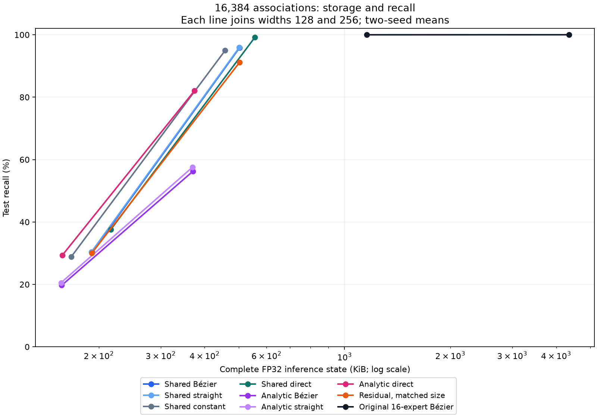

<!-- PUBLICATION-SCOPE -->
> **Historical source in a curated publication.** This document describes the original workspace. Claims that all code, data or weights are available locally do not describe this public snapshot. Some original links, figures and reproduction commands refer to files not distributed here. [Publication scope](../PUBLICATION_SCOPE.md) · [Reader guide](../../READ_THIS_FIRST.md).

# Bezier-Explore: findings

Useful conditional efficiency gains were found. The strongest gains came from sharing a smooth processing field and using an analytically solvable update. The tests do not establish a general advantage from Bézier curvature itself, or greater factual capacity and reliability at every model size.

The project trained and independently verified 90 checkpoints on the RTX 5090: a 72-run main study and an 18-run second-width recall study. All datasets, code, trained weights, raw predictions, measurements and reports are in this folder. Only the existing parent Python/CUDA environment is reused.

## What improved

For handwriting recognition, shared Bézier processing used 2.89× less storage than the original 16-expert model: 510.4 versus 1475.9 KiB for the complete FP32 inference state. Accuracy was 83.90% versus 83.88%. The tiny accuracy difference is not evidence of superiority. A shared model with constant gates also reached 83.91% and occupied even less storage. This is evidence for reusing processing weights, with no clear extra benefit from curved routes.

For 4,096 stored random associations, the shared Bézier model retained 100% test recall with 6.05× less storage than the original model. The straight, constant, direct-gate and ordinary residual controls also achieved 100% recall. These are queries of known associations, not answers to unseen factual questions.

For smooth conditional transformations, the analytic Bézier model occupied 76.9 KiB versus 1076.8 KiB: 14.00× less storage. Its ordinary test normalized MSE was 0.000259, versus 0.000243 for the original model. In the condition interval excluded from both training and validation, its normalized MSE was 0.000496 versus 0.014439, a 29.1× error reduction. The analytic straight-path model did better still (0.000386). This supports smooth shared fields as a useful bias for this structured interpolation problem; it is one synthetic task, not a universal result.

The analytic evaluator was 1.63–3.16× faster at batch 256 than the smallest tested RK4 step count reaching relative output error ≤1e-5 for the same trained field. This acceleration depends on commuting linear operators and polynomial rates. It does not apply to a general nonlinear field. Direct non-geometric gates were faster than spatial evaluation in the end-to-end comparisons.

## What did not hold up

At 16,384 associations, the narrow shared Bézier model recalled only 30.29%. Widening it to 256 hidden features improved recall to 95.81% while remaining 2.30× smaller than the original width-128 model, which reached 99.988%. The non-geometric shared-direct control reached 99.16% and used 2.08× less storage than that original model. The reduced fields trade capacity against size under this fixed training budget.

Reliability did not improve generally. With stronger query noise, the 4,096-fact shared Bézier model fell to 74.48% recall versus 90.20% for the original. On noisy handwriting, the corresponding accuracies were 57.30% and 61.72%. A smaller checkpoint and bounded path coordinates do not guarantee more robust predictions.

## What the mathematics says

Independent expert matrices require approximately 2Mdq processing parameters. A shared low-rank nonlinear field uses approximately 2dq + 20q, plus routing, biases and the encoder/decoder. This replaces independent transformations with a restricted shared family. If the problem has that shared structure, useful computation can fit in fewer weights.

For the analytic variant, the field has the form U diag(a(position)) Uᵀ with one shared orthonormal U. The operators commute, so the final hidden state follows from integrated scalar rates. A spatial polynomial of total degree three becomes a degree-nine polynomial along a cubic Bézier path; five Gauss nodes integrate those rates exactly in real arithmetic. This eliminates repeated hidden-state integration steps. A straight path needs only two nodes, and reversing a path leaves this restricted analytic flow unchanged.

The most defensible direction is compact smooth conditional computation for structured tasks. A broader knowledge-compression claim needs quality-matched size/training sweeps and genuine language or domain-knowledge benchmarks. The present study has two seeds, two widths only for the larger recall task, and no large language-model evaluation.

## Inspect and reproduce

- [Main results, graphs and raw-data links](runs/main/report.html)
- [Second-width recall comparison](runs/capacity/report.html)
- [Implementation mathematics](docs/implementation_math.md)
- [Research background and primary sources](docs/research_background.md)
- [Source layout and reproduction commands](README.md)

All 90 saved models reproduced their stored test predictions after independent reloads. Six mathematical unit tests passed. Frozen source/data hashes, two-seed values, calibration, corruption metrics, actual checkpoint bytes, FP16 weight-round-trip results, route ablations and raw timing repeats are retained. The main interleaved timing rounds observed no other Python compute process; the capacity timing run did observe another workload, so its latency comparison is provisional. All timing is eager FP32 on device-resident inputs, excluding transfers and startup.
