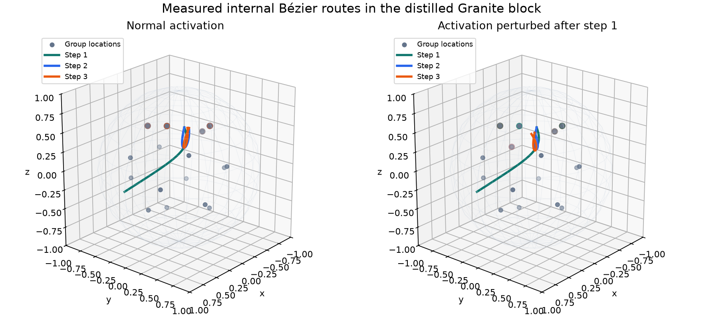

# Granite adaptation results

Local Granite 4.2 30B checkpoint. All comparisons use the same frozen inputs, tokenizer, BF16 compute and SDPA.
The original reference is streamed one decoder layer at a time because both RAM and VRAM are 32 GB.

## Quality-preserving compression

| Model | Stored GiB | Test perplexity | Science QA | Reference-correct retained | Screening targets |
|---|---:|---:|---:|---:|---|
| reference | 54.532 | 20.0618 | 82.42% | 100.00% | passed |
| uniform6 | 22.245 | 20.0780 | 81.25% | 98.10% | passed |
| bezier6 | 22.245 | 20.0582 | 82.03% | 98.58% | passed |

Test: 16,384 next tokens from 64 nonoverlapping WikiText-2 windows and 256 ARC-Easy questions. Validation: 4,096 separate text tokens and 64 questions. QA uses length-normalized answer likelihood. Screening thresholds: perplexity ratio ≤1.10, QA loss ≤2 percentage points, retention ≥95%. Passing these limited screens does not certify every capability. Paired intervals and raw scores are in summary.json.

The reference size is its original tensor payload; compressed sizes include all artifact files, including tokenizer metadata. All transformer projections use six bits plus a float16 scale per 64 values. Embeddings, output head and norms remain BF16. Each Bézier matrix has four float32 control values, a derived 64-entry table, and a code for every weight. Both codecs refine group scales; fitting uses weights only. This is lossy quantization, not a full spherical model.

## Live packed execution

bezier6: persistent tensors 22.235 GiB; measured allocator peak 23.567 GiB; reserved peak 23.883 GiB. Packed versus separately reconstructed dense last-token logits: maximum difference 0.0. 32-token prefill 0.958 seconds.

The custom runtime retains packed weights on GPU and reconstructs only the current matrix. It is eager PyTorch, not a fused low-bit kernel. It targets memory, with no inference-speed advantage claimed. Allocator figures exclude driver/display overhead. Context and generation add KV-cache memory.
The live check uses the same explicit attention-mask path as the evaluator and tokenizer. Omitting the mask in Transformers 4.57.1 enables packed-sequence mask detection and changes the SDPA numerical path; BF16 differences from that path are not weight-decoding errors.

## Shared computation and adaptive routing

One interior MLP (zero-based layer 32) is replaced, while the rest of the compressed 30B model is retained. The replacement shares a 512-feature projection and a rank-128 update across three steps, selecting four of sixteen groups at each step. The Bézier route is replanned from the evolving activation; frozen and fixed controls isolate feedback. Original-model training activations initialize a shared PCA basis and ridge decoder. All replacement weights are then locally distilled, with checkpoint selection on separate validation activations. There is one fitting seed.

| Replacement | Local relative MSE | Later group choices changed | Full-model perplexity | Science QA | Retention |
|---|---:|---:|---:|---:|---:|
| bezier | 0.8021 | 25.20% | 20.2729 | 81.25% | 97.63% |
| frozen | 0.8021 | 0.00% | 20.2454 | 81.25% | 97.63% |
| straight | 0.8021 | 24.02% | 20.2855 | 81.25% | 97.63% |
| fixed | 0.8022 | 0.00% | 20.2709 | 81.25% | 97.63% |

The separate standalone Bézier-routing artifact occupies 21.960 GiB, 291.7 MiB below the practical compressed artifact. It physically omits the three original layer-32 MLP matrices and includes the BF16 replacement weights. The practical artifact remains unchanged.

All four replacements had the same test QA accuracy in this run. Frozen feedback had the lowest test perplexity among them, and the differences were small. These observations do not establish an added quality benefit from Bézier curvature or feedback. The storage reduction comes from the compact distilled replacement.

This illustration selects a validation activation with changed routes. The aggregate intervention rates above, not this selected example, describe how often selections changed.

Practical artifact generation smoke test: 18 generated tokens at 1.08 tokens/second; allocated peak 23.570 GiB. This is one short prompt, not a coding benchmark. Raw prompt, response and timing are saved in runs/.

Experimental artifact generation smoke test: 23 generated tokens at 1.13 tokens/second; allocated peak 23.288 GiB. This is one short prompt, not a coding benchmark. Raw prompt, response and timing are saved in runs/.

The route intervention adds +1 and −1 to two latent components after the first step. Changed later selections demonstrate feedback-dependent routing, not improved reasoning. Sparse group updates still incur gather/dispatch costs; encoder, decoder and routing costs are included in the architecture. Local teacher error, model quality, storage, and speed are separate outcomes. This is a single-block experiment; it does not establish whole-model architectural conversion, general reliability, or long-context behavior.

## Provenance and verification

Source weights remain at the user-supplied location. Per-file source sizes and modification times, source index hash, all artifact hashes, environment versions, exact inputs, learned coefficients and per-question scores are retained. Independent bitstream decoding and live inference checks are recorded alongside these results.

Primary implementation references: [IBM model card](https://huggingface.co/ibm-granite/granite-4.2-30b), [Transformers Granite](https://huggingface.co/docs/transformers/model_doc/granite). The installed Transformers 4.57.1 Granite implementation and the local config define actual computation.
