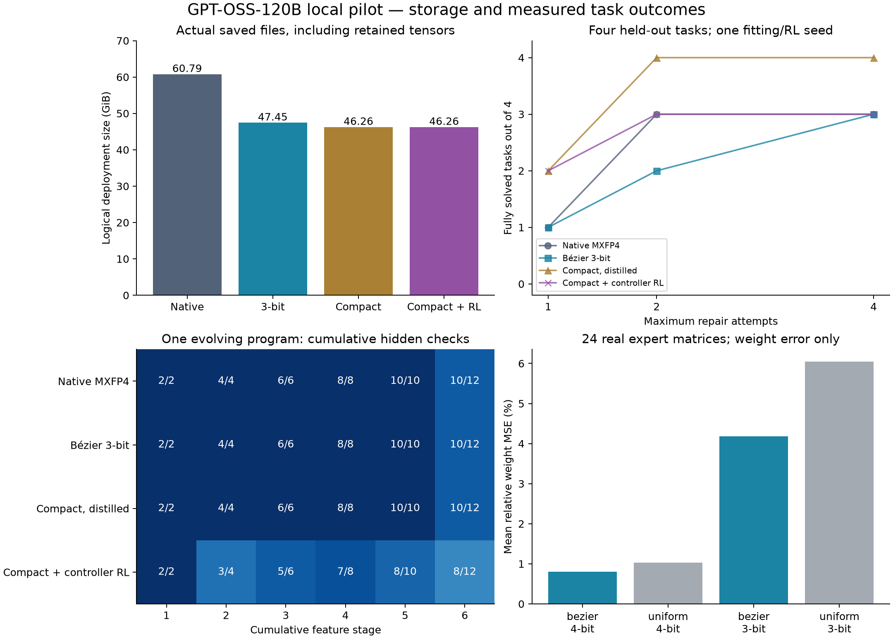
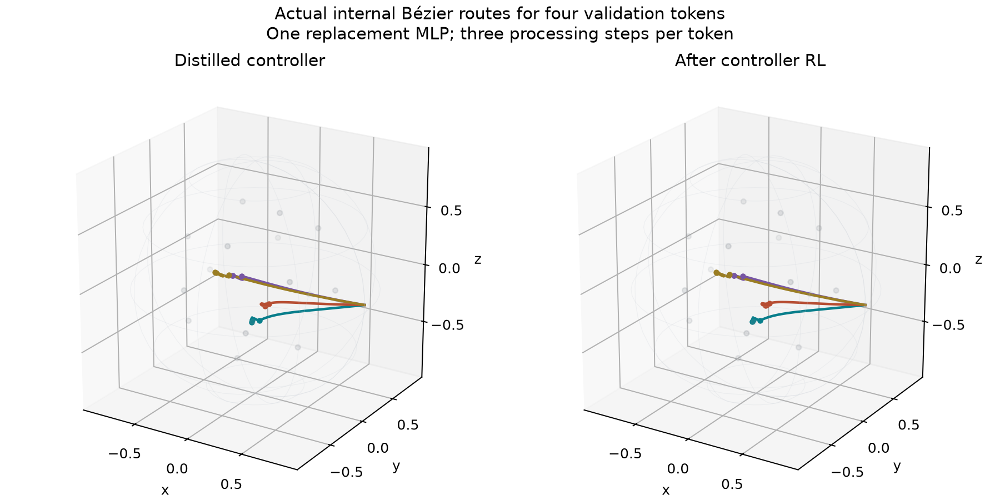

# GPT-OSS-120B local compression and coding results

This is an executed local pilot on the actual pinned GPT-OSS-120B checkpoint. It establishes working compressed artifacts and measured outcomes on four small coding tasks and one six-stage project. It does not establish a general long-horizon advantage.

Compression succeeded. The three-bit version matched the native model's scores in this pilot. The compact model before RL solved one additional coding task under the fixed output limit and matched the native workflow results. Controller RL did not improve these outcomes: it lost that coding success and introduced persistent workflow edge-case failures. This does not disprove the broader architecture hypothesis; the tested adaptation is limited to one expert bank and eight controller-training episodes.

## Artifact sizes

| Variant | Bytes | GiB | Reduction from native |
|---|---:|---:|---:|
| Native MXFP4 | 65,276,850,729 | 60.794 | 0.000% |
| Bézier 3-bit | 50,951,739,855 | 47.453 | 21.945% |
| Compact, distilled | 49,667,088,576 | 46.256 | 23.913% |
| Compact + controller RL | 49,667,088,563 | 46.256 | 23.913% |

The compact RL artifact saves a further 1,284,651,292 bytes (2.521%) relative to the full three-bit artifact. The distilled and RL variants have the same parameter architecture. Their tiny manifest-size difference is metadata, not learned compression. Removing one expert bank causes the extra savings; RL only changes controller weights.

All sizes include configuration, tokenizer, container overhead, and retained tensors. Unchanged export files use NTFS hardlinks. These are logical standalone deployment sizes, not the sum of additional physical disk allocation across all variants.

## Held-out coding results

Greedy decoding, low reasoning effort, at most 384 new tokens per attempt, and identical 20 GiB expert-cache budgets. Public feedback can trigger repairs. Hidden checks never control stopping or candidate selection.

| Variant | Solved by 1 attempt | By 2 | By 4 | Generated tokens | Request minutes |
|---|---:|---:|---:|---:|---:|
| Native MXFP4 | 1/4 | 3/4 | 3/4 | 3,214 | 50.69 |
| Bézier 3-bit | 1/4 | 2/4 | 3/4 | 3,336 | 34.45 |
| Compact, distilled | 2/4 | 4/4 | 4/4 | 1,611 | 6.75 |
| Compact + controller RL | 2/4 | 3/4 | 3/4 | 2,373 | 9.62 |

| Variant | Attempts | Token-capped attempts failing public checks | Completed outputs failing public checks | Selected solutions passing public but failing hidden checks |
|---|---:|---:|---:|---:|
| Native MXFP4 | 9 | 6 | 0 | 0 |
| Bézier 3-bit | 10 | 6 | 1 | 0 |
| Compact, distilled | 6 | 1 | 1 | 0 |
| Compact + controller RL | 8 | 4 | 1 | 0 |

Peak PyTorch-allocated GPU memory in these coding runs: Native MXFP4 25.20 GiB; Bézier 3-bit 25.14 GiB; Compact, distilled 24.34 GiB; Compact + controller RL 25.12 GiB. Driver/context overhead is additional. The weights are streamed from SSD; these deployment artifacts do not fit wholly into the PC's 32 GiB GPU.

These are four authored pure-Python tasks, not SWE-bench or repository-agent results. Timings are descriptive measurements on a shared desktop with SSD streaming; they do not isolate an architectural speedup. The native and three-bit coding runs used the reference decoder with expanded BF16 caching; subsequent runs cached packed experts and used a verified NVRTC decoder. It reproduces decoded weights bitwise and full-model smoke token sequences exactly. The runtime change affects timings and temporary allocations, not the saved weights. Failed and truncated attempts count toward the budget.

The only difference in final solved-task counts is `dependency_times`. The pre-RL compact model completed a correct function at the 384-token limit on its second attempt. All four attempts from each other variant reached the same limit with unfinished solutions. This observed difference is particularly sensitive to the output budget and does not establish stronger general reasoning.

## Six-stage cumulative programming project

The program evolves through stock operations, atomic transfers, nested transactions, snapshots, reserved stock, and atomic batches. Each stage has one generation attempt with a fixed token budget; all earlier tests remain active. The latest valid code, complete contract, and public feedback are carried forward.

A pre-RL compact control was registered before any workflow outcomes were available, after coding results had begun, and run after the primary queue. Its requirements, grader, and token budgets are identical.

| Variant | Fully passing cumulative stages | Final hidden checks | Final stage passed | Generated tokens | Request minutes |
|---|---|---:|---|---:|---:|
| Native MXFP4 | 1, 2, 3, 4, 5 | 10/12 | No | 3,109 | 18.23 |
| Bézier 3-bit | 1, 2, 3, 4, 5 | 10/12 | No | 3,096 | 9.78 |
| Compact, distilled | 1, 2, 3, 4, 5 | 10/12 | No | 2,838 | 8.75 |
| Compact + controller RL | 1 | 8/12 | No | 3,126 | 9.36 |

| Variant | Token-capped stages | Invalid candidates retaining previous code |
|---|---|---|
| Native MXFP4 | 6 | 6 |
| Bézier 3-bit | 6 | 6 |
| Compact, distilled | 6 | 6 |
| Compact + controller RL | 6 | 6 |

Stage token limits are 384, 512, 640, 640, 896, and 1,024, respectively. If a candidate fails syntax or restricted-program validation, the previously valid program is retained and scored against the new cumulative requirements.

At stage two, the RL variant raised a `KeyError` on a hidden zero-quantity operation involving an absent item; the pre-RL compact control passed that stage. Related absent-item failures persisted in the RL program through later stages. These completed-output failures are distinct from truncation. Because the same defect can fail multiple cumulative stages, the stage counts are not independent regression counts.

This is one project with dependent stages, not six independent samples. It tests cumulative feature maintenance with condensed state, not hours-long agency or retaining an entire unabridged conversation. The largest prompt across these runs is 1,657 tokens; the largest prompt plus generated output is 2,681 tokens. This is not a full-context-length benchmark.

## What RL actually trained

The 3,098,057-parameter replacement uses 16 groups, four selected per step, and three internal processing steps. All its processing weights were fitted by supervised distillation on 1,244 training tokens, with 345 separate validation tokens. The selected Bézier checkpoint was step 600 of 800. The field state resets for each token; it adds no persistent memory across tokens beyond the unchanged transformer attention cache.

REINFORCE then updated 16,841 controller parameters over 8 episodes, using 2,226 generated training tokens and 32.04 minutes. The reward was the training test pass fraction minus 0.05 times the token-budget fraction used. Each episode allowed two attempts of 256 tokens. An exponential moving-average baseline and gradient clipping were used. Evaluation uses deterministic controller means.

The controller weight change has L2 norm 0.013205; all non-controller replacement tensors are bitwise unchanged by RL. The pretrained base remained frozen. No full-parameter RL of the original 117B model was performed.

On 1/4 held-out tasks, the pre-RL and post-RL variants generated exactly the same token sequences across all attempts. This exact-output comparison excludes timing differences.

In the cumulative workflow, 1/6 stages have identical pre-RL and post-RL generated token sequences. Later stages can receive different carried code when earlier generations differ; this is a trajectory comparison, not six independent fixed-input comparisons.

| Episode | Training task | Reward | Generated tokens |
|---:|---|---:|---:|
| 1 | merge_intervals | 0.7314 | 190 |
| 2 | dependency_batches | -0.0500 | 512 |
| 3 | window_counts | 0.9828 | 176 |
| 4 | rpn_evaluation | 0.9771 | 235 |
| 5 | merge_intervals | 0.7314 | 190 |
| 6 | dependency_batches | -0.0500 | 512 |
| 7 | window_counts | 0.9828 | 176 |
| 8 | rpn_evaluation | 0.9771 | 235 |

Eight episodes on four training tasks and one seed are a feasibility check for the learning loop. Training rewards are not held-out performance estimates.

## Mechanism checks and controls

| Fitted controller mode | Validation relative output MSE |
|---|---:|
| bezier | 0.09026643 |
| straight | 0.09014777 |
| frozen | 0.09020119 |

After RL, the Bézier replacement has validation relative output MSE 0.09026879. These local reconstruction scores are very close across curved, straight-path, and frozen-feedback fitting controls. They do not demonstrate a curvature advantage. The controls were not all given matched held-out coding evaluations, so coding differences cannot be attributed specifically to curve geometry.

The frozen-feedback control uses the initial latent state for routing at every step; its position and phase inputs still evolve. It disables feedback from the updated processing state, rather than freezing every controller input.

The actual traversal point is the cubic midpoint. Curves shown below trace the traversed half-segment exactly, rather than a separate illustrative path. All control points stay within the unit ball. The field changes subsequent group selections when its internal state is perturbed, confirming that feedback affects computation.

## Weight reconstruction screen

Twenty-four real matrices cover early, middle, and late layers and four expert IDs. Both methods use matched code/scale budgets. These numbers measure requantization error against the already-quantized native weights, not language-model quality. The uniform control is conventional signed symmetric quantization with one unused code (7 or 15 usable levels); the Bézier codebook uses all 8 or 16 levels. This comparison does not isolate curve geometry from codebook placement or utilization.

| Codec | Mean relative weight MSE | Sample payload bytes |
|---|---:|---:|
| bezier 4-bit | 0.008054 | 158,632,320 |
| uniform 4-bit | 0.010322 | 158,631,936 |
| bezier 3-bit | 0.041830 | 121,306,752 |
| uniform 3-bit | 0.060498 | 121,306,368 |

The four-bit Bézier codec has the same 4.25-bit effective weight budget as native MXFP4; its small control metadata makes the sampled payload slightly larger. A full four-bit duplicate was therefore not made. The full three-bit artifact uses 3.25 effective bits per expert weight before small metadata overheads.

## Verification and provenance

- Native source revision: `b5c939de8f754692c1647ca79fbf85e8c1e70f8a`; all 15 source shards independently match their saved Hugging Face SHA-256 ETags.
- MXFP4 decoding matches the independent upstream decoder across every packed nibble value and multiple exponents.
- Streamed expert computation matches a dense native reference; standalone replacement loading also matches reference logits on a tiny architecture fixture.
- Three-bit artifact: 4,608 expert-file hashes verified; 543 retained tensors match the native source bitwise.
- RL export: 4,480 expert-file hashes verified; 539 retained tensors match; all 132 replaced files are physically absent.
- A complete-model generation reloads the standalone RL export using its own tokenizer and manifest.
- All 22 implementation checks passed after the packed-cache runtime update; the recorded log is `runs/tests_after_packed_cache.log`.
- Raw outputs, tests, token IDs, per-task results, and subprocess completion receipts are preserved locally.

See [README.md](README.md) for reproduction commands and artifact locations, [coding protocol](runs/coding_protocol.json), [workflow protocol](runs/workflow_protocol.json), [pre-RL workflow control registration](runs/workflow_control_protocol.json), [machine-readable results](runs/results.json), [report consistency audit](runs/report_audit.json), and [RL diagnostics](runs/rl_diagnostics.json).

The experiment supports conclusions about these concrete saved models and these limited tasks. A general claim about long-horizon reasoning requires broader independent projects, more fitting/RL seeds, higher reasoning budgets, and matched geometry controls.
