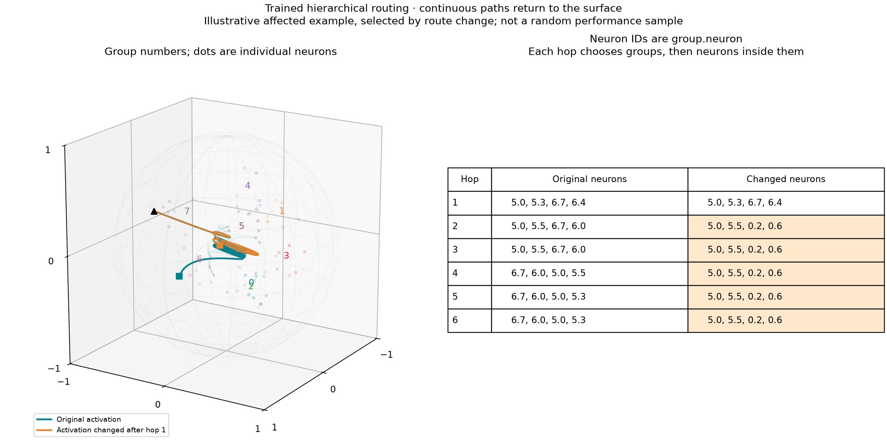

# Bezier-Routing

An independent experiment in **changing a Bézier route after intermediate neural computation**. All source, copied data, checkpoints, traces and reports for this experiment are kept in this folder. It uses the already-installed Python environment at `WORKSPACE\.venv`; it does not modify the earlier model or the other sibling projects.

The earlier geometric model selected its complete curve from the entry activation. It already visited multiple processing groups, while the ordinary MoE baseline updated non-geometric choices at every step. This project addresses the untested geometric feedback mechanism specifically.

## Three implemented modes

| Mode | Selection at each hop | Neurons executed per hop |
|---|---|---:|
| Individual neurons | Choose four neurons from all 64 | 4 |
| Groups | Choose two groups and execute all eight neurons in each | 16 |
| Hierarchical | Choose two groups, then two neurons within each chosen group | 4 |

Each mode updates a carried feature vector. Each individual neuron produces one scalar activation and contributes through its outgoing synaptic weights. The updated feature vector, position and hop index can change the next proposed curve. The hierarchy can stay within a group or select different groups on later hops. After six internal hops, a final curve reaches the sphere's surface.

Soft branches visit selected neurons and their contributions recombine. The combined path is continuous in position and stays inside the ball. This is an artificial neural architecture, not a physical or spiking-neuron simulation. Its spatial coordinates organize computation; the carried features hold information.

Every mode also has a comparison that feeds the planner the original entry activation throughout the run. These pairs have identical stored parameters, initialization and active-neuron budgets. Extra controls use straight hierarchical routes and ordinary direct neuron selection. See [the mathematical design and prospective comparison plan](docs/design.md).

## Completed first experiment

**The activation can redirect later curves, switch groups and select different neurons. A general performance benefit is not established.** All 24 planned runs completed on the RTX 5090. All 24 checkpoints independently reproduced their saved predictions and passed intervention/geometry checks; all 13 unit checks passed.

[Open the complete report and route illustration](runs/digits/report.html), [raw summary](runs/digits/summary.json), or [verification record](runs/digits/verification.json).

The same 360 held-out digit images are used across all runs, with three training seeds. These are exploratory results on the reused parent-project test split:

| Routing granularity | Entry-state route | Activation feedback | Mean change |
|---|---:|---:|---:|
| Individual neurons | 94.54% | 95.37% | +0.83 pp |
| Groups | 95.93% | 96.85% | +0.93 pp |
| Groups then neurons | 95.19% | 94.35% | -0.83 pp |

Each paired model contains 16,110 parameters and has an approximately 68 KiB inference checkpoint. Each pair executes the same number of neurons. The group-only model executes 96 neuron calls per input; the flat-neuron and hierarchical models execute 24. Accuracy error bars and individual seed results are in the report. Paired-image 95% bootstrap intervals for the three mean changes are [-0.56,+2.22], [-0.19,+2.04] and [-2.22,+0.56] percentage points. These intervals condition on the three trained pairs and exclude training-seed uncertainty; all include zero.

The dynamic hierarchy with straight segments scored 94.54%; direct non-geometric neuron selection scored 95.74% using 20,270 stored parameters. These exploratory controls do not show an advantage specific to curved hierarchical routing.

Changing two activation components after hop 1 changed **44.80% of later neuron-selection sets and 16.35% of later group-selection sets** in the trained hierarchy, averaged over seeds and all test inputs. The corresponding frozen hierarchy changed neither. During normal inference, the feedback hierarchy changed its selected group set on 16.98% of adjacent hops. The paths remain inside the ball and exit at radius one.

Disabling feedback in the already-trained hierarchy reduces its mean accuracy from 94.35% to 89.54%; bypassing its neuron updates reduces it to 50.19%. This establishes reliance on those computations, while the separately trained frozen hierarchy still has the higher measured accuracy. Those are different comparisons.



The pictured test sample is deliberately selected for changed routes. Whole-test intervention rates above provide the denominator. Reproduce its normal and changed neuron sequence with `--sample 8`, with and without `--intervention 1`. The sample illustrates a branch switching from group 6 to group 0 after the activation change.

## Use the project

Run these commands from `WORKSPACE\Bezier-Routing`:

```powershell
# Geometry, hierarchy, causal routing, sparse-reference and GPU checks.
..\.venv\Scripts\python.exe -m pytest -q

# Train/evaluate all 24 planned runs, render results and verify every checkpoint.
.\scripts\run.ps1 -Output runs\repeat -Device cuda

# Inspect actual learned group and neuron choices for a test digit.
..\.venv\Scripts\python.exe -m bezier_routing.predict --sample 0

# Change the intermediate activation after the first hop; inspect the new route.
..\.venv\Scripts\python.exe -m bezier_routing.predict --sample 0 --intervention 1 --after-hop 1
```

The initial experiment uses `runs/digits`. Completed runs can be resumed with unchanged scientific sources and settings. A partially trained run restarts from its seed. Every completed configuration saves its checkpoint, full validation history, nominal predictions and counterfactual traces. Training does not select checkpoints using test accuracy.

The initial task reuses the small digit split from the parent project. It can show whether the new mechanism works and provide an exploratory accuracy comparison. It cannot settle large-scale efficiency, knowledge compression, or general reliability. No latency result is claimed while other project work may share the GPU.

## Artifacts

- `bezier_routing/model.py`: neuron bank, group selection, hierarchical selection and feedback planner.
- `bezier_routing/experiment.py`: fixed comparisons and intermediate-activation interventions.
- `bezier_routing/predict.py`: inspect a route or supply an 8×8 digit JSON array, pixels 0–16.
- `runs/digits/report.html`: complete measured results and route illustrations.
- `runs/digits/*/trace.json`: actual paths and selected group/neuron IDs before and after intervention.
- `runs/digits/verification.json`: independently reloaded predictions and causal checks.
- `data/digits_split2026.npz`: local copy of the exact dataset and split.
- `requirements-lock.txt`: exact dependencies from the shared project-local environment.

Existing recursive routing research makes this a plausible hypothesis to test; it does not demonstrate that Bézier geometry itself is superior. Sources and interpretation limits are in the design document.
