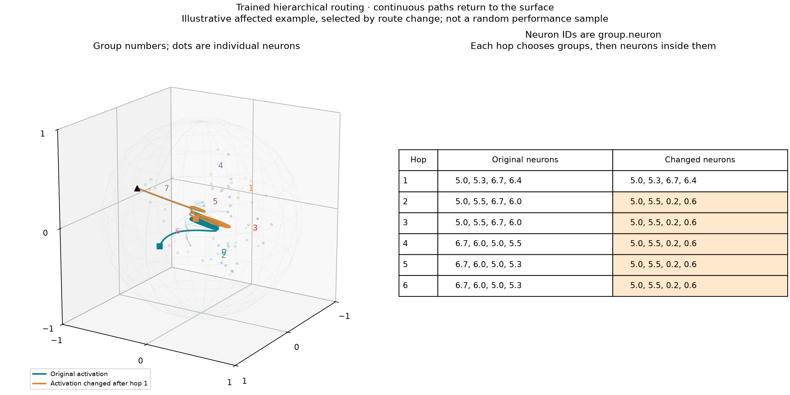

<!-- PUBLICATION-SCOPE -->
> **Historical source in a curated publication.** This document describes the original workspace. Claims that all code, data or weights are available locally do not describe this public snapshot. Some original links, figures and reproduction commands refer to files not distributed here. [Publication scope](../../../PUBLICATION_SCOPE.md) · [Reader guide](../../../../READ_THIS_FIRST.md).

# Activation-dependent Bézier routing

Twenty-four exploratory runs: eight configurations and training seeds 7, 19 and 42. Same 1,078 training / 359 validation / 360 test digit examples as the earlier project; this is a reused test set, not a new untouched benchmark. Eighty epochs; checkpoint selection uses validation loss. Each feedback/frozen pair starts from identical weights, with the same parameter and active-neuron budgets. No hyperparameters were selected using these new test results.

| Model | Parameters | Neuron calls | Test accuracy ± SD | Later neurons changed | Later groups changed | Group switches | KiB |
|---|---|---|---|---|---|---|---|
| Neurons · entry state | 16,110 | 24 | 94.54% ± 1.67 pp | 0.00% | 0.00% | 15.37% | 68.1 |
| Neurons · feedback | 16,110 | 24 | 95.37% ± 0.42 pp | 59.28% | 34.20% | 29.00% | 68.1 |
| Groups · entry state | 16,110 | 96 | 95.93% ± 0.70 pp | 0.00% | 0.00% | 4.54% | 68.0 |
| Groups · feedback | 16,110 | 96 | 96.85% ± 0.16 pp | 21.59% | 21.59% | 14.04% | 68.0 |
| Hierarchy · entry state | 16,110 | 24 | 95.19% ± 0.42 pp | 0.00% | 0.00% | 8.63% | 68.1 |
| Hierarchy · feedback | 16,110 | 24 | 94.35% ± 0.70 pp | 44.80% | 16.35% | 16.98% | 68.1 |
| Hierarchy · straight + feedback | 16,110 | 24 | 94.54% ± 1.05 pp | 39.41% | 12.85% | 17.91% | 68.1 |
| Direct neuron gate · feedback | 20,270 | 24 | 95.74% ± 0.70 pp | 65.31% | 58.17% | 47.00% | 84.7 |

neurons: mean feedback-minus-frozen accuracy +0.83 percentage points; per-seed differences -0.83, +3.06, +0.28. Paired-image bootstrap 95% interval [-0.56, +2.22] pp, conditional on the three trained pairs; excludes seed uncertainty.
groups: mean feedback-minus-frozen accuracy +0.93 percentage points; per-seed differences +1.39, +1.11, +0.28. Paired-image bootstrap 95% interval [-0.19, +2.04] pp, conditional on the three trained pairs; excludes seed uncertainty.
hierarchical: mean feedback-minus-frozen accuracy -0.83 percentage points; per-seed differences -0.83, +0.28, -1.94. Paired-image bootstrap 95% interval [-2.22, +0.56] pp, conditional on the three trained pairs; excludes seed uncertainty.

The intervention adds +1 and -1 to the first two carried-state components after hop 1. Later-neuron/group-change columns are fractions of later input–hop pairs whose selected sets change, over all 360 test inputs and five later hops. The first hop remains unchanged. Frozen comparisons must keep their entire route unchanged. Group switches count adjacent hops with different selected group sets on normal inputs; switching alone does not prove beneficial specialization.

## Interventions on trained models

The following interventions change computation in already-trained models while keeping their weights fixed. An accuracy drop establishes reliance on that computation, not superiority over a separately trained alternative. The primary feedback/frozen comparisons above train each alternative independently.

| Trained model | Normal accuracy | Feedback disabled | Neuron updates bypassed |
|---|---|---|---|
| Neurons · feedback | 95.37% | 93.61% | 57.50% |
| Groups · feedback | 96.85% | 95.65% | 53.80% |
| Hierarchy · feedback | 94.35% | 89.54% | 50.19% |
| Hierarchy · straight + feedback | 94.54% | 92.50% | 43.52% |
| Direct neuron gate · feedback | 95.74% | 92.78% | 44.72% |

Mechanistic rerouting and better learning are separate findings. Each neuron produces a scalar, but a feature vector is carried and soft branches recombine. The hierarchy narrows group selection before scoring neurons within those groups, with new decisions at each hop. Group-only routing executes four times as many neurons per hop as the neuron and hierarchical modes. The direct control has extra gate parameters and retains geometry for visualization, which does not affect its neuron choices. Hard top-k choices are non-smooth. These small, reused digit tests cannot establish knowledge compression, general reliability, or large-scale inference savings. No latency comparison was made because other project work may share the GPU.

Raw intervention traces, source snapshots, checkpoints and per-run metrics are saved beside this report.