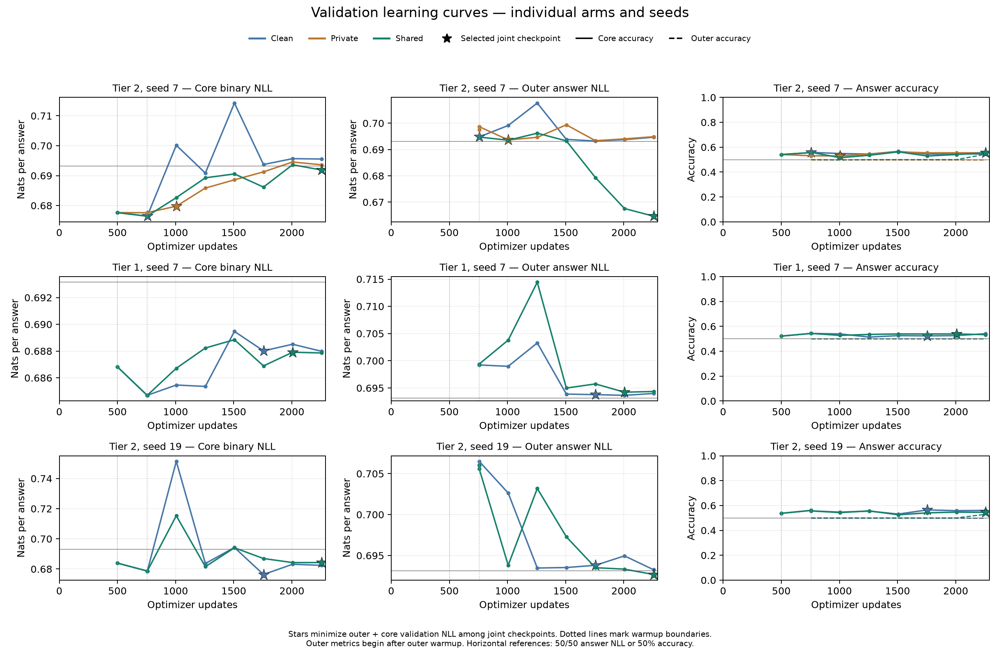

# Bézier nested-core scale-up study

**Completed bounded study.** Study status: `complete`; 7/7 arm/seed results recorded in suites.

Report snapshot: 2026-11-25T00:01:26+00:00.

The central core has a fixed location at the origin and a target budget of 5% of the shared model. Its complete weights and biases serve outer computation, initial routing, redirect scoring, and direct Boolean reasoning. The private control duplicates the controller core; the clean control disables redirect checking while retaining the core and direct reasoning supervision.

## Design and execution status

| Group | Planned controls | Suite status | Recorded runs | Measured suite seconds |
| --- | --- | --- | --- | --- |
| tier2_seed7 | Clean, Private, Shared | complete | 3/3 | 392.99 |
| tier1_seed7 | Clean, Shared | complete | 2/2 | 211.63 |
| tier2_seed19 | Clean, Shared | complete | 2/2 | 229.12 |

| Tier | Outer width / hidden / regions | Core dimensions | Core params | Shared total params | Core fraction | Core radius |
| --- | --- | --- | --- | --- | --- | --- |
| 2 | 256 / 512 / 16 | 256 → 458 → 256 | 235,210 | 4,704,970 | 4.99918% | 0.25 |
| 1 | 64 / 128 / 8 | 64 → 71 → 64 | 9,223 | 183,239 | 5.03332% | 0.25 |

Counts above are calculated from the declared architecture; per-checkpoint measured counts appear below. Fixed projections and geometry buffers are not learned parameters. A private controller adds one complete core budget.

| Tier | Updates | Core warmup | Outer warmup | Joint | Core batch | Joint batch | Core warmup LR | Joint initial LR | LR schedule |
| --- | --- | --- | --- | --- | --- | --- | --- | --- | --- |
| 2 | 2256 | 500 | 256 | 1500 | 256 | 64 | 0.003 | 0.001 | cosine |
| 1 | 2256 | 500 | 256 | 1500 | 256 | 64 | 0.003 | 0.001 | cosine |

The final state retains all requested updates. `best.pt` is the joint checkpoint minimizing the sum of full-validation outer NLL and direct-core NLL. Warmup checkpoints cannot win that selection. Redirect thresholds are also selected on validation; test and longer-program OOD results do not select checkpoints.

The planned evaluation uses every example in each preserved validation, test, and OOD split (512 examples each). The outer task predicts the ASCII answer in the full 256-token vocabulary; direct core reasoning is binary. NLL values are in nats per answer.

| Run | Status | Updates observed | Selected joint step | Validation selection score | Measured training seconds |
| --- | --- | --- | --- | --- | --- |
| T2 / seed 7 / Clean | recorded in suite | 2256 | 757 | 1.3713 | 63.68 |
| T2 / seed 7 / Private | recorded in suite | 2256 | 1006 | 1.3734 | 120.03 |
| T2 / seed 7 / Shared | recorded in suite | 2256 | 2256 | 1.3565 | 112.88 |
| T1 / seed 7 / Clean | recorded in suite | 2256 | 1756 | 1.3818 | 56.58 |
| T1 / seed 7 / Shared | recorded in suite | 2256 | 2006 | 1.3821 | 107.90 |
| T2 / seed 19 / Clean | recorded in suite | 2256 | 1756 | 1.3701 | 64.00 |
| T2 / seed 19 / Shared | recorded in suite | 2256 | 2256 | 1.3769 | 119.04 |

Training times come from saved trainer wall-clock measurements and include its validation/checkpoint overhead. Suite times include evaluation and requested runtime audits. Partial times are elapsed observations, not estimates of completion.

## Validation learning curves

Every curve is an individual run. No training-seed averaging or cross-seed confidence interval is inferred from these seven runs.

## Complete-test and longer-program results

| Run | Examples: test outer/core; OOD outer/core | Outer acc. | Outer NLL | Core acc. | Core NLL | OOD outer acc. | OOD outer NLL | OOD core acc. | OOD core NLL |
| --- | --- | --- | --- | --- | --- | --- | --- | --- | --- |
| T2 / seed 7 / Clean | 512 / 512 / 512 / 512 | 50.00% | 0.6948 | 59.38% | 0.6522 | 50.00% | 0.6954 | 50.39% | 1.2229 |
| T2 / seed 7 / Private | 512 / 512 / 512 / 512 | 49.61% | 0.6936 | 56.84% | 0.6566 | 50.00% | 0.6936 | 50.39% | 1.3602 |
| T2 / seed 7 / Shared | 512 / 512 / 512 / 512 | 53.52% | 0.6705 | 58.79% | 0.6446 | 53.71% | 0.6690 | 50.00% | 1.3660 |
| T1 / seed 7 / Clean | 512 / 512 / 512 / 512 | 50.00% | 0.6938 | 56.25% | 0.6776 | 50.00% | 0.6937 | 50.00% | 0.8138 |
| T1 / seed 7 / Shared | 512 / 512 / 512 / 512 | 50.00% | 0.6939 | 55.27% | 0.6820 | 50.00% | 0.6939 | 49.61% | 0.7825 |
| T2 / seed 19 / Clean | 512 / 512 / 512 / 512 | 50.00% | 0.6938 | 59.57% | 0.6472 | 50.00% | 0.6938 | 48.83% | 1.7419 |
| T2 / seed 19 / Shared | 512 / 512 / 512 / 512 | 51.76% | 0.6931 | 59.77% | 0.6484 | 53.12% | 0.6927 | 49.02% | 1.7315 |

Outer results here use 16 visits and the validation-selected full redirect cap. OOD uses that same selected threshold; it does not retune on longer programs. Core accuracy uses the parameter-free syntax adapter, the core itself, and a fixed readout, with no learned outer encoder.

## Paired program comparisons

Positive gain means the candidate has lower answer NLL. Intervals resample whole held-out programs, paired within the same seed. They quantify program sampling uncertainty, not training-seed uncertainty. Each seed remains separate; the small/large seed-7 contrast is descriptive.

| Run | Visits | Comparison | NLL gain | 95% paired CI | Programs / examples | Draws | Positive lower bound |
| --- | --- | --- | --- | --- | --- | --- | --- |
| T2 / seed 7 / Clean | 8 | Full vs zero | 0.000000 | [0.000000, 0.000000] | 32 / 512 | 10000 | fail |
| T2 / seed 7 / Clean | 8 | Full vs one | 0.000000 | [0.000000, 0.000000] | 32 / 512 | 10000 | fail |
| T2 / seed 7 / Clean | 8 | Full vs clean | 0.000000 | [0.000000, 0.000000] | 32 / 512 | 10000 | fail |
| T2 / seed 7 / Clean | 16 | Full vs zero | 0.000000 | [0.000000, 0.000000] | 32 / 512 | 10000 | fail |
| T2 / seed 7 / Clean | 16 | Full vs one | 0.000000 | [0.000000, 0.000000] | 32 / 512 | 10000 | fail |
| T2 / seed 7 / Clean | 16 | Full vs clean | 0.000000 | [0.000000, 0.000000] | 32 / 512 | 10000 | fail |
| T2 / seed 7 / Private | 8 | Full vs zero | 0.000547 | [0.000453, 0.000650] | 32 / 512 | 10000 | pass |
| T2 / seed 7 / Private | 8 | Full vs one | 0.000096 | [0.000058, 0.000137] | 32 / 512 | 10000 | pass |
| T2 / seed 7 / Private | 8 | Full vs clean | 0.000873 | [0.000818, 0.000927] | 32 / 512 | 10000 | pass |
| T2 / seed 7 / Private | 16 | Full vs zero | 0.000418 | [0.000358, 0.000484] | 32 / 512 | 10000 | pass |
| T2 / seed 7 / Private | 16 | Full vs one | 0.000072 | [0.000052, 0.000094] | 32 / 512 | 10000 | pass |
| T2 / seed 7 / Private | 16 | Full vs clean | 0.001193 | [0.001133, 0.001255] | 32 / 512 | 10000 | pass |
| T2 / seed 7 / Shared | 8 | Full vs zero | 0.000000 | [0.000000, 0.000000] | 32 / 512 | 10000 | fail |
| T2 / seed 7 / Shared | 8 | Full vs one | 0.000000 | [0.000000, 0.000000] | 32 / 512 | 10000 | fail |
| T2 / seed 7 / Shared | 8 | Full vs clean | 0.024355 | [0.016726, 0.031967] | 32 / 512 | 10000 | pass |
| T2 / seed 7 / Shared | 16 | Full vs zero | 0.000000 | [0.000000, 0.000000] | 32 / 512 | 10000 | fail |
| T2 / seed 7 / Shared | 16 | Full vs one | 0.000000 | [0.000000, 0.000000] | 32 / 512 | 10000 | fail |
| T2 / seed 7 / Shared | 16 | Full vs clean | 0.024267 | [0.016643, 0.031852] | 32 / 512 | 10000 | pass |
| T1 / seed 7 / Clean | 8 | Full vs zero | 0.000000 | [0.000000, 0.000000] | 32 / 512 | 10000 | fail |
| T1 / seed 7 / Clean | 8 | Full vs one | 0.000000 | [0.000000, 0.000000] | 32 / 512 | 10000 | fail |
| T1 / seed 7 / Clean | 8 | Full vs clean | 0.000000 | [0.000000, 0.000000] | 32 / 512 | 10000 | fail |
| T1 / seed 7 / Clean | 16 | Full vs zero | 0.000000 | [0.000000, 0.000000] | 32 / 512 | 10000 | fail |
| T1 / seed 7 / Clean | 16 | Full vs one | 0.000000 | [0.000000, 0.000000] | 32 / 512 | 10000 | fail |
| T1 / seed 7 / Clean | 16 | Full vs clean | 0.000000 | [0.000000, 0.000000] | 32 / 512 | 10000 | fail |
| T1 / seed 7 / Shared | 8 | Full vs zero | 0.000000 | [0.000000, 0.000000] | 32 / 512 | 10000 | fail |
| T1 / seed 7 / Shared | 8 | Full vs one | 0.000000 | [0.000000, 0.000000] | 32 / 512 | 10000 | fail |
| T1 / seed 7 / Shared | 8 | Full vs clean | -0.000101 | [-0.000120, -0.000080] | 32 / 512 | 10000 | fail |
| T1 / seed 7 / Shared | 16 | Full vs zero | 0.000000 | [0.000000, 0.000000] | 32 / 512 | 10000 | fail |
| T1 / seed 7 / Shared | 16 | Full vs one | -0.000012 | [-0.000015, -0.000008] | 32 / 512 | 10000 | fail |
| T1 / seed 7 / Shared | 16 | Full vs clean | -0.000172 | [-0.000183, -0.000161] | 32 / 512 | 10000 | fail |
| T2 / seed 19 / Clean | 8 | Full vs zero | 0.000000 | [0.000000, 0.000000] | 32 / 512 | 10000 | fail |
| T2 / seed 19 / Clean | 8 | Full vs one | 0.000000 | [0.000000, 0.000000] | 32 / 512 | 10000 | fail |
| T2 / seed 19 / Clean | 8 | Full vs clean | 0.000000 | [0.000000, 0.000000] | 32 / 512 | 10000 | fail |
| T2 / seed 19 / Clean | 16 | Full vs zero | 0.000000 | [0.000000, 0.000000] | 32 / 512 | 10000 | fail |
| T2 / seed 19 / Clean | 16 | Full vs one | 0.000000 | [0.000000, 0.000000] | 32 / 512 | 10000 | fail |
| T2 / seed 19 / Clean | 16 | Full vs clean | 0.000000 | [0.000000, 0.000000] | 32 / 512 | 10000 | fail |
| T2 / seed 19 / Shared | 8 | Full vs zero | 0.000000 | [0.000000, 0.000000] | 32 / 512 | 10000 | fail |
| T2 / seed 19 / Shared | 8 | Full vs one | 0.000000 | [0.000000, 0.000000] | 32 / 512 | 10000 | fail |
| T2 / seed 19 / Shared | 8 | Full vs clean | 0.000619 | [0.000530, 0.000711] | 32 / 512 | 10000 | pass |
| T2 / seed 19 / Shared | 16 | Full vs zero | 0.000211 | [-0.000283, 0.000607] | 32 / 512 | 10000 | fail |
| T2 / seed 19 / Shared | 16 | Full vs one | -0.000012 | [-0.000058, 0.000035] | 32 / 512 | 10000 | fail |
| T2 / seed 19 / Shared | 16 | Full vs clean | 0.000746 | [0.000247, 0.001157] | 32 / 512 | 10000 | pass |

The zero/one-cap comparisons reuse the same checkpoint. The clean comparison uses a separately trained matched clean arm. The private arm also has additional parameters, so it is not a parameter-matched test of sharing.

## Steering and region coverage

| Run | Selected threshold | Mean redirects | Shell regions selected | Core selected / visits | Core selected outside radius | Geometric core entry | Max exit drift |
| --- | --- | --- | --- | --- | --- | --- | --- |
| T2 / seed 7 / Clean | 0.2000 | 0.000 | 4/15 | 69.73% | 48.84% | 100.00% | 0.00000000 |
| T2 / seed 7 / Private | 0.2000 | 4.000 | 6/15 | 50.00% | 33.33% | 100.00% | 0.00000000 |
| T2 / seed 7 / Shared | 0.2000 | 0.000 | 9/15 | 47.25% | 47.25% | 0.00% | 0.00000000 |
| T1 / seed 7 / Clean | 0.2000 | 0.000 | 4/7 | 96.88% | 95.83% | 100.00% | 0.00000000 |
| T1 / seed 7 / Shared | 0.2000 | 0.000 | 4/7 | 75.00% | 75.00% | 0.00% | 0.00000000 |
| T2 / seed 19 / Clean | 0.2000 | 0.000 | 3/15 | 43.75% | 25.00% | 100.00% | 0.00000000 |
| T2 / seed 19 / Shared | 0.0000 | 1.980 | 4/15 | 36.56% | 16.34% | 96.68% | 0.00000000 |

A visit blends the two nearest region centers. The fixed core radius describes location; it is not a hard execution gate. Geometric entry and selection of core weights are distinct. A high redirect count alone does not show beneficial steering.

## Quality and integrity gates

The quality criterion requires positive 16-visit program-paired lower bounds against zero/one/clean, core reasoning above fixed baselines, and selected control better than Stay. Integrity additionally requires whole-core sharing and participation, fixed central geometry, and preserved exit location. Latency is reported separately and cannot turn a quality failure into success.

| Run | All requested phase updates retained | Complete 512-example heldout evaluations | Evaluated best joint validation checkpoint |
| --- | --- | --- | --- |
| T2 / seed 7 / Clean | pass | pass | pass |
| T2 / seed 7 / Private | pass | pass | pass |
| T2 / seed 7 / Shared | pass | pass | pass |
| T1 / seed 7 / Clean | pass | pass | pass |
| T1 / seed 7 / Shared | pass | pass | pass |
| T2 / seed 19 / Clean | pass | pass | pass |
| T2 / seed 19 / Shared | pass | pass | pass |

| Run | Measured params | Added vs clean | Whole-core sharing | All three core roles | Fixed origin/radius | Exit drift < 1e-5 | Quality criterion | Combined gate |
| --- | --- | --- | --- | --- | --- | --- | --- | --- |
| T2 / seed 7 / Clean | 4,704,970 | 0 | pass | control arm | pass | pass | control arm | not applicable |
| T2 / seed 7 / Private | 4,940,180 | 235,210 | private by design | control arm | pass | pass | control arm | not applicable |
| T2 / seed 7 / Shared | 4,704,970 | 0 | pass | pass | pass | pass | fail | fail |
| T1 / seed 7 / Clean | 183,239 | 0 | pass | control arm | pass | pass | control arm | not applicable |
| T1 / seed 7 / Shared | 183,239 | 0 | pass | pass | pass | pass | fail | fail |
| T2 / seed 19 / Clean | 4,704,970 | 0 | pass | control arm | pass | pass | control arm | not applicable |
| T2 / seed 19 / Shared | 4,704,970 | 0 | pass | pass | pass | pass | fail | fail |

Bounded-study combined outcome across its shared runs: **fail**. This does not certify the larger original research protocol or general logical reasoning.

Core elementwise gradient coverage is diagnostic; the audit requires participation of each complete tensor, not a nonzero gradient in every element on one batch. Exit drift measures observed evaluated trajectories. These observations do not substitute for source-level geometry tests.

| Run | Audited post-visit checkpoint | Examples | Chosen vs Stay gain | 95% program CI | Chosen harm fraction | Mean local regret |
| --- | --- | --- | --- | --- | --- | --- |
| T2 / seed 7 / Clean | 1 | 512 | 0.000000 | [0.000000, 0.000000] | 0.00% | 0.001292 |
| T2 / seed 7 / Private | 1 | 512 | -0.000031 | [-0.000050, -0.000013] | 50.00% | 0.006736 |
| T2 / seed 7 / Shared | 1 | 512 | 0.000000 | [0.000000, 0.000000] | 0.00% | 0.014309 |
| T1 / seed 7 / Clean | 1 | 512 | 0.000000 | [0.000000, 0.000000] | 0.00% | 0.006991 |
| T1 / seed 7 / Shared | 1 | 512 | 0.000000 | [0.000000, 0.000000] | 0.00% | 0.003863 |
| T2 / seed 19 / Clean | 1 | 512 | 0.000000 | [0.000000, 0.000000] | 0.00% | 0.000550 |
| T2 / seed 19 / Shared | 1 | 512 | 0.000301 | [-0.000126, 0.000656] | 2.15% | 0.004172 |

The offline controller audit evaluates equal-budget continuations from the same activation at the stated checkpoint. Inference executes only its chosen continuation. Calibration at one checkpoint does not establish calibration at every later decision.

## Concurrent execution and measured latency

tier2_seed7: measured eager kernel overlap = **pass**; graph overlap = **pass**; overlap with checker disabled = **True**.

| Execution | Batch | Visits | Median ms | p95 ms | Peak allocated MiB | Warmup / timed forwards |
| --- | --- | --- | --- | --- | --- | --- |
| clean-outer | 1 | 16 | 8.712 | 8.939 | 36.60 | 50 / 100 |
| clean-outer | 16 | 16 | 8.759 | 13.850 | 76.79 | 50 / 100 |
| nested-core-concurrent | 1 | 16 | 26.558 | 27.045 | 45.72 | 50 / 100 |
| nested-core-concurrent | 16 | 16 | 18.885 | 28.080 | 85.99 | 50 / 100 |
| nested-core-pipeline-reference | 1 | 16 | 16.827 | 24.919 | 37.60 | 50 / 100 |
| nested-core-pipeline-reference | 16 | 16 | 25.399 | 26.364 | 76.86 | 50 / 100 |
| clean-outer-graph | 1 | 16 | 1.296 | 1.300 | 34.78 | 50 / 100 |
| clean-outer-graph | 16 | 16 | 2.054 | 2.240 | 36.84 | 50 / 100 |
| nested-core-concurrent-graph | 1 | 16 | 1.811 | 1.990 | 43.91 | 50 / 100 |
| nested-core-concurrent-graph | 16 | 16 | 2.682 | 2.690 | 45.96 | 50 / 100 |
| nested-core-pipeline-reference-graph | 1 | 16 | 2.213 | 2.546 | 36.78 | 50 / 100 |
| nested-core-pipeline-reference-graph | 16 | 16 | 3.090 | 3.414 | 36.84 | 50 / 100 |

tier1_seed7: runtime audit not scheduled for this group.

tier2_seed19: runtime audit not scheduled for this group.

Overlap proves simultaneous kernel execution, not speedup. Latency uses separate unprofiled CUDA-event forwards with FP32 computation. The pipeline reference uses the same concurrent checkpoint and delayed policy, isolating scheduling. Allocator measurements include resident weights, workspaces, and graph pools.

## Limits and evidence

The large tier has seeds 7 and 19; the small tier has seed 7 only. There is no cross-seed confidence estimate. The study includes clean/shared controls at both scales and a private-core control only for large seed 7. Other ablations and depths from the larger original protocol are not executed here.

The original revision-2 pilot differed in training data volume, optimizer updates, model size, and core fraction. A comparison with that pilot cannot isolate a single causal change. These reused benchmark holdouts are not a new sequestered confirmation set.

- `study.json` records the planned groups and completion status.
- Each group’s `suite.json` records matched controls, provenance, completed results, and gates.
- Each run’s `training_summary.json`, `train.jsonl`, and `validation.jsonl` record measured training and selection.
- `best.pt` is the validation-selected joint checkpoint; `final.pt` retains the requested training endpoint.
- Each run’s `evaluation/` contains program-level losses, selected thresholds, OOD results, and sampled traces.
- Each run’s `audits.json` records weight identity, participation, and cross-masking.
- Scheduled `runtime_audits/audits.json` records profiler evidence and isolated runtime measurements.
